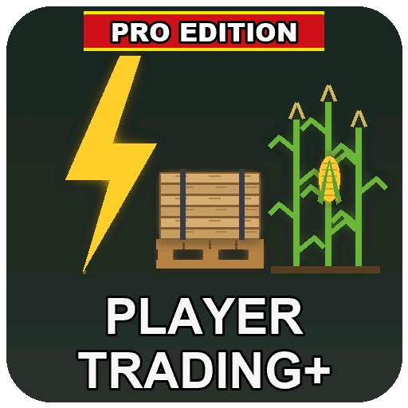

# ModHub upload: Player Trading+ Pro Edition

What to enter in the GIANTS ModHub upload form for this mod. Each text box below has a copy button on GitHub.



**Mod Icon (512x512):** [`icon_512.png`](icon_512.png)

| Field | Value |
|-------|-------|
| Title English | Player Trading+ Pro Edition |
| Title German | Player Trading+ Pro Edition |
| Title French | Player Trading+ Pro Edition |
| Version | `0` `12` `1` `1` |
| Author | DTM Mods, PropaineX |
| Manufacturer | Lizard |
| Category 1 | Gameplay |
| Category 2 | Placeable > Selling Points |
| Category 3 | Not Set |

## Title English
```text
Player Trading+ Pro Edition
```

## Title German
```text
Player Trading+ Pro Edition
```

## Title French
```text
Player Trading+ Pro Edition
```

## Description English
```text
Player Trading+ lets farms buy and sell with each other: electricity, slurry, manure, bulk goods such as grain, and pallet goods, through invoices and standing orders. Money only moves between farms. Made for multiplayer; it also works with several farms in single player.

- Invoice a farm, request an invoice, or post a standing buy or sell order that any member farm can fill in part or in full
- Set your own price per 1,000 liters (the game's price is shown as a guide), an amount or everything in stock, a discount, and trade once, daily or weekly
- Goods for sale wait in the depot until the buyer collects them; unsold goods go back home and liters never collected are refunded
- Collect slurry at the tank coupling, manure at the manure pit, bulk goods at the silo pipe and pallets on the pallet pad
- Electricity goes straight from the seller's power productions into the buyer's productions
- Every farm is offered membership of the depot; members share its daily upkeep
- Only farm managers can trade

How to use: buy the Community Depot (shop: Production > Selling Points, 268,000), then open the Player Trading+ page in the ESC menu.

Changelog 0.12.1.0:
- Renamed to Player Trading+ (was Utilities & Waste Management). Invoices and orders carry over; a depot placed under the old name has to be placed again.
- The mod description is up to date.
```

## Description German
```text
Mit Player Trading+ handeln Höfe untereinander: Strom, Gülle, Mist, Schüttgut wie Getreide und Palettenwaren, über Rechnungen und Daueraufträge. Geld fließt nur zwischen den Höfen. Für den Mehrspielermodus gemacht; funktioniert auch mit mehreren Höfen im Einzelspieler.

- Einem Hof eine Rechnung stellen, eine Rechnung anfordern oder einen Kauf- oder Verkaufsauftrag einstellen, den jeder Mitgliedshof ganz oder teilweise erfüllen kann
- Eigener Preis pro 1.000 Liter (der Spielpreis wird als Richtwert angezeigt), eine feste Menge oder alles auf Lager, ein Rabatt, und Handel einmalig, täglich oder wöchentlich
- Angebotene Waren warten im Depot, bis der Käufer sie abholt; Unverkauftes geht zurück, nie abgeholte Liter werden erstattet
- Gülle am Anschluss des Tanks, Mist an der Mistgrube, Schüttgut am Silorohr und Paletten auf dem Palettenplatz abholen
- Strom fließt direkt von den Stromproduktionen des Verkäufers in die Produktionen des Käufers
- Jedem Hof wird die Mitgliedschaft im Depot angeboten; die Mitglieder teilen sich den täglichen Unterhalt
- Nur Hofmanager können handeln

So geht's: das Community Depot kaufen (Shop: Produktion > Verkaufsstellen, 268.000), dann die Seite Player Trading+ im ESC-Menü öffnen.

Changelog 0.12.1.0:
- Umbenannt in Player Trading+ (vorher Utilities & Waste Management). Rechnungen und Aufträge bleiben erhalten; ein unter dem alten Namen platziertes Depot muss neu platziert werden.
- Die Modbeschreibung ist auf dem neuesten Stand.
```

## Description French
```text
Player Trading+ permet aux fermes d'acheter et de vendre entre elles : électricité, lisier, fumier, vrac comme les céréales, et marchandises en palettes, par factures et ordres permanents. L'argent ne circule qu'entre les fermes. Conçu pour le multijoueur ; fonctionne aussi avec plusieurs fermes en solo.

- Facturer une ferme, demander une facture, ou publier un ordre d'achat ou de vente que toute ferme membre peut remplir en partie ou en totalité
- Votre prix par 1 000 litres (le prix du jeu sert de repère), une quantité ou tout le stock, une remise, et un échange unique, quotidien ou hebdomadaire
- Les marchandises en vente attendent au dépôt jusqu'à ce que l'acheteur les récupère ; les invendus repartent et les litres non récupérés sont remboursés
- Lisier au raccord de la cuve, fumier à la fosse, vrac au tuyau du silo, palettes sur l'aire à palettes
- L'électricité va directement des productions électriques du vendeur vers celles de l'acheteur
- Chaque ferme peut adhérer au dépôt ; les membres partagent son entretien quotidien
- Seuls les gestionnaires de ferme peuvent échanger

Utilisation : achetez le Community Depot (boutique : Production > Points de vente, 268 000), puis ouvrez la page Player Trading+ dans le menu Échap.

Changelog 0.12.1.0 :
- Renommé Player Trading+ (anciennement Utilities & Waste Management). Factures et ordres sont conservés ; un dépôt placé sous l'ancien nom doit être replacé.
- La description du mod est à jour.
```

## Before uploading

- Work in progress: version 0.12.1.0 has not been fully tried in game yet. ModHub expects a finished, tested mod; test it fully (and consider a 1.0.0.0 version) before uploading.
- Translations in the mod itself: English only. The title, description and every menu, page and shop text have no German or French.
