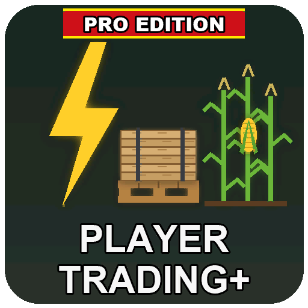

# ModHub upload: Player Trading+ Pro Edition

What to enter in the GIANTS ModHub upload form for this mod. Each text box below has a copy button on GitHub.



**Mod Icon (512x512):** [`icon_512.png`](icon_512.png)

| Field | Value |
|-------|-------|
| Title English | Player Trading+ Pro Edition |
| Title German | Player Trading+ Pro Edition |
| Title French | Player Trading+ Pro Edition |
| Version | `0` `12` `1` `1` |
| Author | DTM Mods, PropaineX |
| Manufacturer | Lizard |
| Category 1 | Gameplay |
| Category 2 | Placeable > Selling Points |
| Category 3 | Not Set |

## Title English
```text
Player Trading+ Pro Edition
```

## Title German
```text
Player Trading+ Pro Edition
```

## Title French
```text
Player Trading+ Pro Edition
```

## Description English
```text
Category: Production > Selling Points (Community Depot)
Price: $268,000
Monthly upkeep: $268, shared equally by the depot's owner and member farms

Farms buy and sell with each other: electricity, slurry, manure, bulk goods (grain and more) and pallet goods, through invoices and standing orders. Money only moves between farms.

Open the Player Trading+ page in the ESC menu (or at the depot office door). Press New to invoice a farm, request an invoice, or post a standing buy or sell order that any farm can fill in part or in full. Set your own price per 1,000 liters (the game's price is shown as a guide), a set amount or everything in stock, an optional discount, and trade once, every day or every week. Only farm managers can trade.

Everything runs through the Community Depot, the building this mod adds to the shop. Without a depot on the map there is no trading. One depot per map; the server admin can allow more on the Player Trading+ page.

Every other farm is offered membership of the depot. Members and the owner share the depot's upkeep equally; it is taken every day. A member who can't pay builds up a debt; two months in a row ending in debt and the farm is suspended until it pays. A member can leave, but can't rejoin for 6 months; any debt is taken from its account when it leaves, even into the red. Farms that said no or are suspended can't trade. Invoices they already paid can still be collected or ended.

Goods put up for sale leave the seller's storage and wait in the depot until the buyer collects them; unsold goods go back home. Buyers pay up front and anyone on the buying farm collects at the depot: slurry at the tank's coupling, manure at the open end of the manure pit, bulk goods at the silo pipe, pallets on the pallet pad. Liters that are never collected are refunded when the invoice ends. Electricity goes straight from the seller's power-producing productions into the productions the buyer picked, and is paid for as it arrives.

Multiplayer: everything runs on the server.
```

## Description German
```text
Kategorie: Produktion > Verkaufsstellen (Community Depot)
Preis: 268.000 €
Monatliche Unterhaltskosten: 268 €, zu gleichen Teilen auf Besitzer und Mitgliedshöfe des Depots verteilt

Höfe kaufen und verkaufen untereinander: Strom, Gülle, Mist, Schüttgut (Getreide und mehr) und Palettenware, über Rechnungen und Daueraufträge. Geld fließt nur zwischen den Höfen.

Öffne die Seite Player Trading+ im ESC-Menü (oder an der Bürotür des Depots). Drücke "New", um einem Hof eine Rechnung zu stellen, eine Rechnung anzufordern oder einen Dauerauftrag zum Kaufen oder Verkaufen einzustellen, den jeder Hof ganz oder teilweise erfüllen kann. Lege deinen eigenen Preis pro 1.000 Liter fest (der Preis des Spiels wird als Richtwert angezeigt), eine feste Menge oder den gesamten Vorrat, einen optionalen Rabatt, und handle einmalig, täglich oder wöchentlich. Nur Farmmanager können handeln.

Alles läuft über das Community Depot, das Gebäude, das dieser Mod in den Shop bringt. Ohne Depot auf der Karte gibt es keinen Handel. Ein Depot pro Karte; der Server-Admin kann auf der Seite Player Trading+ weitere erlauben.

Jedem anderen Hof wird die Mitgliedschaft im Depot angeboten. Mitglieder und Besitzer teilen sich die Unterhaltskosten des Depots zu gleichen Teilen; sie werden täglich abgebucht. Ein Mitglied, das nicht zahlen kann, macht Schulden; endet es zwei Monate in Folge mit Schulden, wird der Hof gesperrt, bis er zahlt. Ein Mitglied kann austreten, aber 6 Monate lang nicht wieder eintreten; offene Schulden werden beim Austritt vom Konto abgebucht, auch ins Minus. Höfe, die abgelehnt haben oder gesperrt sind, können nicht handeln. Bereits bezahlte Rechnungen können sie trotzdem noch abholen oder beenden.

Zum Verkauf gestellte Waren verlassen das Lager des Verkäufers und warten im Depot, bis der Käufer sie abholt; nicht verkaufte Waren gehen zurück. Käufer zahlen im Voraus, und jeder auf dem kaufenden Hof holt am Depot ab: Gülle an der Kupplung des Tanks, Mist am offenen Ende der Mistplatte, Schüttgut am Silorohr, Paletten auf dem Palettenplatz. Liter, die nie abgeholt werden, werden erstattet, wenn die Rechnung endet. Strom fließt direkt von den stromerzeugenden Produktionen des Verkäufers in die Produktionen, die der Käufer gewählt hat, und wird bezahlt, sobald er ankommt.

Multiplayer: alles läuft auf dem Server.
```

## Description French
```text
Catégorie : Production > Points de vente (Community Depot)
Prix : 268 000 €
Entretien mensuel : 268 €, partagé à parts égales entre le propriétaire du dépôt et les fermes membres

Les fermes achètent et vendent entre elles : électricité, lisier, fumier, vrac (céréales et autres) et marchandises en palettes, par factures et ordres permanents. L'argent ne circule qu'entre les fermes.

Ouvrez la page Player Trading+ dans le menu Échap (ou à la porte du bureau du dépôt). Appuyez sur New pour facturer une ferme, demander une facture, ou publier un ordre permanent d'achat ou de vente que toute ferme peut remplir en partie ou en totalité. Fixez votre propre prix par 1 000 litres (le prix du jeu sert de repère), une quantité fixe ou tout le stock, une remise facultative, et échangez une fois, chaque jour ou chaque semaine. Seuls les gestionnaires de ferme peuvent échanger.

Tout passe par le Community Depot, le bâtiment que ce mod ajoute à la boutique. Sans dépôt sur la carte, pas d'échanges. Un dépôt par carte ; l'administrateur du serveur peut en autoriser davantage sur la page Player Trading+.

Chaque autre ferme se voit proposer l'adhésion au dépôt. Les membres et le propriétaire partagent à parts égales l'entretien du dépôt, prélevé chaque jour. Un membre qui ne peut pas payer accumule une dette ; s'il termine deux mois de suite endetté, la ferme est suspendue jusqu'à ce qu'elle paie. Un membre peut partir, mais ne peut pas revenir avant 6 mois ; toute dette est prélevée sur son compte à son départ, même dans le rouge. Les fermes qui ont refusé ou qui sont suspendues ne peuvent pas échanger. Les factures déjà payées peuvent quand même être récupérées ou terminées.

Les marchandises mises en vente quittent le stockage du vendeur et attendent au dépôt jusqu'à ce que l'acheteur les récupère ; les invendus retournent à la ferme. Les acheteurs paient d'avance et n'importe qui de la ferme acheteuse récupère au dépôt : le lisier au raccord de la cuve, le fumier à l'extrémité ouverte de la fosse à fumier, le vrac au tuyau du silo, les palettes sur l'aire à palettes. Les litres jamais récupérés sont remboursés à la fin de la facture. L'électricité va directement des productions électriques du vendeur vers les productions choisies par l'acheteur, et est payée à mesure qu'elle arrive.

Multijoueur : tout se passe sur le serveur.
```

## Before uploading

- Screenshots for the upload: [`modhub/screenshots/`](screenshots) (1600x900, unedited in-game shots, `1.jpg` first).
- Translations in the mod itself: English only. The title, description and every menu, page and shop text have no German or French.
